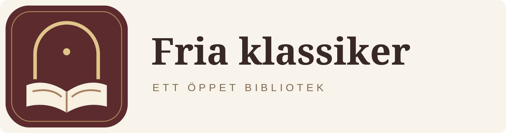

# Antik filosofi. Nytt liv på svenska.

**Ett öppet bibliotek med klassiska filosofiska texter, fritt tillgängliga för läsning och granskning.**

[📚 Läs biblioteket](https://friaklassiker.github.io/fria-klassiker/) · [🔎 Se projektets källkod](https://github.com/FriaKlassiker/fria-klassiker) · [✍️ Rapportera en rättelse](https://github.com/FriaKlassiker/fria-klassiker/issues)

### Vad finns här?

Platons dialoger, Aristoteles *Kategorierna*, Epiktetos *Handboken*, försokratiska fragment och delar av Platons *Staten*, på svenska. Utgåvorna erbjuds för läsning online och som **PDF** och **EPUB**.

### Öppenhet före skenbar säkerhet

Materialet är **AI-översatt och ännu inte filologiskt fackgranskat**. Vi redovisar modeller, textunderlag, licens, källor och granskningsstatus. *Staten* omfattar endast bok I–II.

Bidrag, källkontroller, språkliga förbättringar och andra rättelser är välkomna.

**Licens:** CC BY-SA 4.0 för de utgåvor som publiceras med den märkningen. Kontrollera källangivelser per verk.
